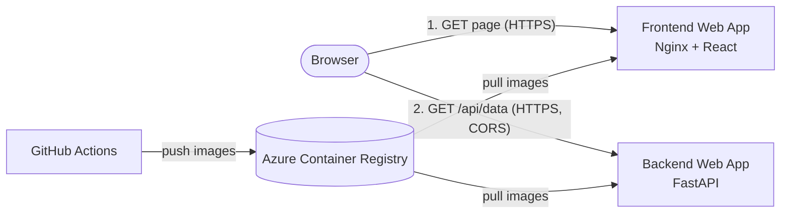

# CC2026 – Applications

Application repository for the *Cloud Computing* project (UTCN, Master's in Data Science, 2026–2027).

> Students: name your copy `CC2026_LastName_FirstName_Apps`. This reference copy is called `CC2026_DS_Applications`.
> The infrastructure lives in the companion repository `CC2026_LastName_FirstName_Infra`, which also has the full, step-by-step **Student Deployment Walkthrough** (`docs/student-walkthrough.md`).

## 1. Overview

| Part | Technology | What it does |
|---|---|---|
| Backend | Python 3.15 + FastAPI | REST API with device measurements (`/api/data`) |
| Frontend | React 19 + TypeScript + Vite, served by Nginx | Dashboard that fetches and displays the measurements |
| Packaging | Docker (one image per app) | Same image runs on your laptop and in Azure |
| Hosting | Azure App Service (Linux containers) | Two Web Apps, each with its own public HTTPS URL |
| CI/CD | GitHub Actions + OIDC | Test → build image → push to ACR → deploy, on every push to `main` |

## 2. Architecture



The browser loads the static React app from the frontend, then calls the backend **directly**. The backend allows that cross-origin call through CORS. More diagrams: [docs/architecture.md](docs/architecture.md).

## 3. Repository structure

```text
backend/
  app/main.py              FastAPI app: endpoints and CORS
  app/config.py            settings from environment variables
  app/models.py            Pydantic models (response schemas)
  app/data.py              data source interface + in-memory data (P2: swap for Blob Storage)
  tests/test_api.py        pytest tests
  requirements.txt         runtime dependencies (in the image)
  requirements-dev.txt     + test dependencies (CI and local)
  Dockerfile
frontend/
  src/
    App.tsx                page layout
    api.ts                 HTTP call to the backend
    config.ts              reads the runtime API URL
    hooks/useMeasurements.ts  loading / error / data state
    components/            DeviceFilter, MeasurementsTable, SummaryTiles, BackendVersion
    types.ts               shared TypeScript types
  public/config.js         runtime config for `npm run dev`
  docker/40-runtime-config.sh  writes config.js when the container starts
  nginx.conf               Nginx site (SPA routing, /healthz, caching)
  Dockerfile               multi-stage: Node build → Nginx runtime
scripts/wait-for-version.sh  used by CI to wait for a deployment
.github/workflows/         backend.yml, frontend.yml
docker-compose.yml         local stack
```

## 4. Prerequisites

- Git
- Docker Desktop (or Docker Engine with the Compose plugin)
- Optional, to run without Docker: Python 3.15 and Node.js 26

## 5. Run locally

```bash
docker compose up --build
```

| URL | What you should see |
|---|---|
| http://localhost:3000 | Dashboard with summary tiles and a table of measurements |
| http://localhost:8000/api/data | JSON list of measurements |
| http://localhost:8000/docs | Interactive API documentation (Swagger UI) |

Stop and remove the containers with `Ctrl+C`, then:

```bash
docker compose down
```

If port 3000 or 8000 is taken, copy `.env.example` to `.env` and change the ports there.

> **macOS (zsh):** the commands in this README have `# comments` at the end of the line. Default zsh does not treat `#` as a comment in the terminal and passes it to the command. Run `setopt interactivecomments` once (add it to `~/.zshrc` to make it permanent). On Windows, run everything inside WSL2 (Ubuntu).

Without Docker (Python 3.15 and Node.js 26):

```bash
# backend: create a virtual environment, run the tests, start the API on http://localhost:8000
cd backend
python3 -m venv .venv
source .venv/bin/activate
pip install -r requirements-dev.txt
python -m pytest
uvicorn app.main:app --reload

# frontend, in a second terminal: http://localhost:3000
cd frontend
npm ci
npm run dev
```

## 6. Test the endpoints

```bash
curl http://localhost:8000/health
curl http://localhost:8000/api/data
curl "http://localhost:8000/api/data?device_id=device-002"
curl http://localhost:8000/api/data/device-001
curl -i http://localhost:8000/api/data/device-999       # 404 Device not found
curl -i 'http://localhost:8000/api/data/BAD_ID!'        # 422 validation error
```

| Endpoint | Success | Errors |
|---|---|---|
| `GET /health` | `200` `{"status":"ok","service":"cc2026-backend","version":"<git sha>","timestamp":…}` (`"local"` instead of the SHA when run locally) | – |
| `GET /api/data` | `200` list of measurements | `422` invalid `device_id` filter |
| `GET /api/data/{device_id}` | `200` measurements of one device | `404` unknown device, `422` invalid ID |
| `GET /api/devices` | `200` sorted device IDs | – |
| `GET /api/stats` | `200` per-device reading count and averages | – |

## 7. How the Dockerfiles work

**Backend** (`backend/Dockerfile`): starts from `python:3.15-slim`. It installs `requirements.txt` first, so Docker caches that layer and rebuilds it only when dependencies change. Then it copies the code, switches to an unprivileged user and starts Uvicorn on `0.0.0.0:8000`. The build argument `APP_VERSION` (the Git commit SHA in CI) is reported by `/health`.

**Frontend** (`frontend/Dockerfile`) has two stages:
1. `node:26-alpine` runs `npm ci` and `npm run build` (type-check + Vite build) and produces static files in `dist/`.
2. `nginxinc/nginx-unprivileged` serves `dist/` on port **8080** as a non-root user. Node.js and the source code are not in the final image.

## 8. How Docker Compose works

`docker-compose.yml` builds both images, starts both containers on a private network, and maps ports to your machine (`8000→8000`, `3000→8080`). The frontend waits until the backend health check passes.

## 9. Frontend ↔ backend communication

The React code runs **in your browser**, not inside Docker. So the browser must call the backend at a URL it can reach (`http://localhost:8000` locally, `https://<backend>.azurewebsites.net` in Azure). Docker's internal name `http://backend:8000` would not work from the browser.

Because frontend and backend have different origins, the backend must allow the frontend's origin through **CORS** (`CORS_ORIGINS`).

## 10. Runtime configuration

| Variable | App | Local value (Compose) | Azure value (set by Terraform) |
|---|---|---|---|
| `API_BASE_URL` | frontend | `http://localhost:8000` | `https://<backend-app>.azurewebsites.net` |
| `CORS_ORIGINS` | backend | `http://localhost:3000` | `https://<frontend-app>.azurewebsites.net` |
| `WEBSITES_PORT` | both (Azure only) | – | `8000` backend, `8080` frontend |

The backend URL is **not** compiled into the JavaScript. When the frontend container starts, `docker/40-runtime-config.sh` writes `/config.js`:

```js
window.APP_CONFIG = { API_BASE_URL: "https://cc2026-api-agi-dev-1a2b.azurewebsites.net" };
```

`index.html` loads `config.js` before the React bundle, so the same image works everywhere. Only public values go there; the browser can read everything in it.

## 11. GitHub Actions workflows

| Workflow | Trigger | Jobs |
|---|---|---|
| `backend.yml` | push to `main` touching `backend/**`, `scripts/wait-for-version.sh` or the workflow file; pull requests touching `backend/**` or the workflow file; manual | `test` (pytest) → `deploy` |
| `frontend.yml` | push to `main` touching `frontend/**`, `scripts/wait-for-version.sh` or the workflow file; pull requests touching `frontend/**` or the workflow file; manual | `build` (type-check + Vite build) → `deploy` |

A push that changes only documentation starts no workflow. The `deploy` job runs only on `main` (never for pull requests) and only once `bootstrap.sh` has set the `AZURE_CLIENT_ID` variable; before that it is skipped and the run is still green.

The `deploy` job:
1. Signs in to Azure with **OIDC** (`azure/login`). GitHub issues a short-lived token that Azure trusts, so no password or secret is stored.
2. `az acr login` and `docker build --build-arg APP_VERSION=<sha>`.
3. Pushes `<image>:<commit-sha>` (immutable, deployed) and `<image>:latest` (only used when Terraform first creates the Web App).
4. Points the Web App at the new tag: `az webapp config set --linux-fx-version "DOCKER|<acr>/<image>:<sha>"`.
5. Polls `/health` (backend) or `/version.txt` (frontend) until the new commit SHA is served (up to ~10–15 minutes).

If the Web App does not exist yet (first deployment), steps 4–5 are skipped with a notice.

**GitHub variables used** (set by `bootstrap.sh` in the Infra repo; *Settings → Secrets and variables → Actions → Variables*):

| Variable | Source |
|---|---|
| `AZURE_CLIENT_ID`, `AZURE_TENANT_ID`, `AZURE_SUBSCRIPTION_ID` | Entra application created by bootstrap |
| `ACR_NAME` | Terraform `acr_name` |
| `RESOURCE_GROUP` | Terraform `resource_group_name` |
| `BACKEND_WEBAPP_NAME`, `FRONTEND_WEBAPP_NAME` | Terraform `backend_webapp_name`, `frontend_webapp_name` |

## 12. How images are deployed

Ownership is split on purpose:

- **Terraform** (Infra repo) creates the registry, the Web Apps and their settings. It sets the *initial* image (`:latest`) and then ignores later image changes (`ignore_changes` on the image name only).
- **These workflows** decide *which* image version runs (`:<commit-sha>`).

To roll back, point the Web App at an older image that is still in ACR (every deployed commit has its `:<sha>` tag):

```bash
az acr repository show-tags --name <acr-name> --repository backend --orderby time_desc --output table
az webapp config set --resource-group <rg> --name <backend-webapp> \
  --linux-fx-version "DOCKER|<acr-name>.azurecr.io/backend:<old-sha>"
```

Re-running an older workflow run also works, but it rebuilds the image from source (base images may have changed) and overwrites `:latest`. The next push to `main` deploys the newest commit again.

## 13. Azure URLs

After deployment (names include your initials and a 4-character suffix):

- Frontend: `https://cc2026-ui-<initials>-dev-<suffix>.azurewebsites.net`
- Backend: `https://cc2026-api-<initials>-dev-<suffix>.azurewebsites.net/api/data`
- API docs: `https://cc2026-api-<initials>-dev-<suffix>.azurewebsites.net/docs`

The exact URLs are printed by the Terraform workflow (*Summary* tab) and by `terraform output`.

| Reference deployment | URL |
|---|---|
| Frontend | https://cc2026-ui-agi-dev-465d.azurewebsites.net |
| Backend | https://cc2026-api-agi-dev-465d.azurewebsites.net/api/data |
| API docs | https://cc2026-api-agi-dev-465d.azurewebsites.net/docs |

## 14. Troubleshooting

| Symptom | Likely cause | Fix |
|---|---|---|
| Dashboard: "Cannot reach the backend at …" | Backend down, wrong `API_BASE_URL`, or CORS | Open `<frontend>/config.js` and check the URL; open `<backend>/health`; check `CORS_ORIGINS` on the backend Web App |
| Browser console: `blocked by CORS policy` | Frontend origin not in `CORS_ORIGINS` | The origin must match exactly (scheme + host, no trailing slash) |
| `docker compose up` fails: port is already allocated | Port 3000/8000 in use | Set other ports in `.env` (see `.env.example`) |
| Workflow fails at **Azure login** with `AADSTS70021`/`AADSTS700213` | Federated credential subject does not match | Workflow must run on `main` of the exact repository configured by bootstrap; re-run bootstrap if you renamed the repo |
| Workflow fails at `az acr login` | `ACR_NAME` variable missing or registry not created yet | Run the Infra `terraform` workflow first |
| Verify step times out | Container failed to start | Azure portal → Web App → *Log stream*, or `az webapp log tail -g <rg> -n <app>` |
| Web App shows "Application Error" right after creation | Image pull still in progress or role propagation | Wait 2–5 minutes, then *Restart* the Web App |

## 15. Extending in later project parts

- New data source (P2): implement `MeasurementSource` in `backend/app/data.py` and return it from `get_measurement_source()`. The endpoints and tests do not change, and tests can inject a fake source (`app.dependency_overrides`).
- New setting: add a field to `Settings` in `backend/app/config.py`. In Azure, Terraform sets it through `backend_app_settings`.
- New public frontend setting (e.g. a sign-in client ID in P3): extend `RuntimeConfig` (`frontend/src/types.ts`) and `docker/40-runtime-config.sh`.
- New deployable app (e.g. an Azure Function): copy `backend.yml` and adapt the build/deploy steps.

The infrastructure side is described in the Infra repository: `docs/extending.md`.

## 16. Stop local containers

```bash
docker compose down          # stop and remove containers + network
docker compose down --rmi local   # also remove the locally built images
```
