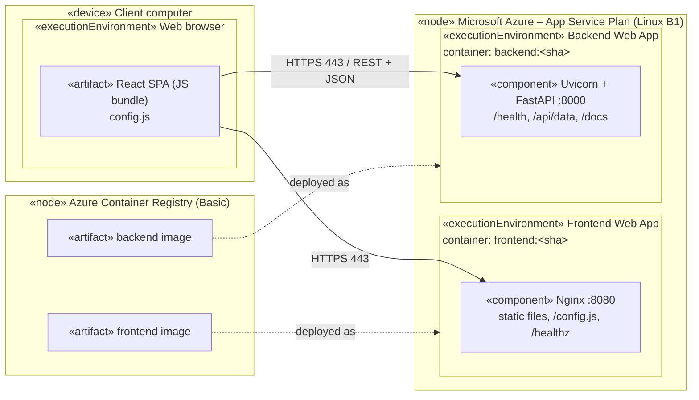
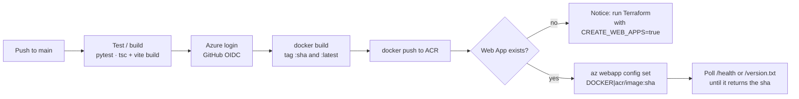

# Architecture – CC2026 P1 Applications

Diagrams below describe what is actually deployed. Nothing else (no database, no gateway, no monitoring service) is part of P1.

## Conceptual architecture

```mermaid
flowchart TB
    subgraph Users
        browser([User browser])
        dev([Student / developer])
    end

    subgraph GitHub
        repo[CC2026_..._Apps repository]
        gha[GitHub Actions<br/>backend.yml / frontend.yml]
    end

    subgraph Azure["Azure subscription"]
        subgraph rg["Resource group rg-cc2026-&lt;initials&gt;-dev"]
            acr[(Azure Container Registry<br/>backend:&lt;sha&gt;, frontend:&lt;sha&gt;)]
            subgraph plan["App Service Plan (Linux, B1)"]
                fe["Frontend Web App<br/>Nginx + React (port 8080)"]
                be["Backend Web App<br/>FastAPI (port 8000)"]
            end
            id[Managed identity<br/>AcrPull]
        end
    end

    dev -- git push --> repo --> gha
    gha -- "OIDC login + docker push" --> acr
    gha -- "set image tag" --> fe & be
    acr -- "pull (managed identity)" --> fe & be
    id -.- fe & be
    browser -- "HTTPS: HTML/JS" --> fe
    browser -- "HTTPS: GET /api/data (CORS)" --> be
```

## UML deployment diagram

Mermaid has no native UML deployment diagram, so nodes and artifacts are drawn with UML stereotypes.

App Service terminates TLS on port 443 and forwards traffic to the port given by `WEBSITES_PORT` (8080 frontend, 8000 backend).

## CI/CD flow

Pull requests run only the test/build job. Azure credentials are never available to pull request runs.
