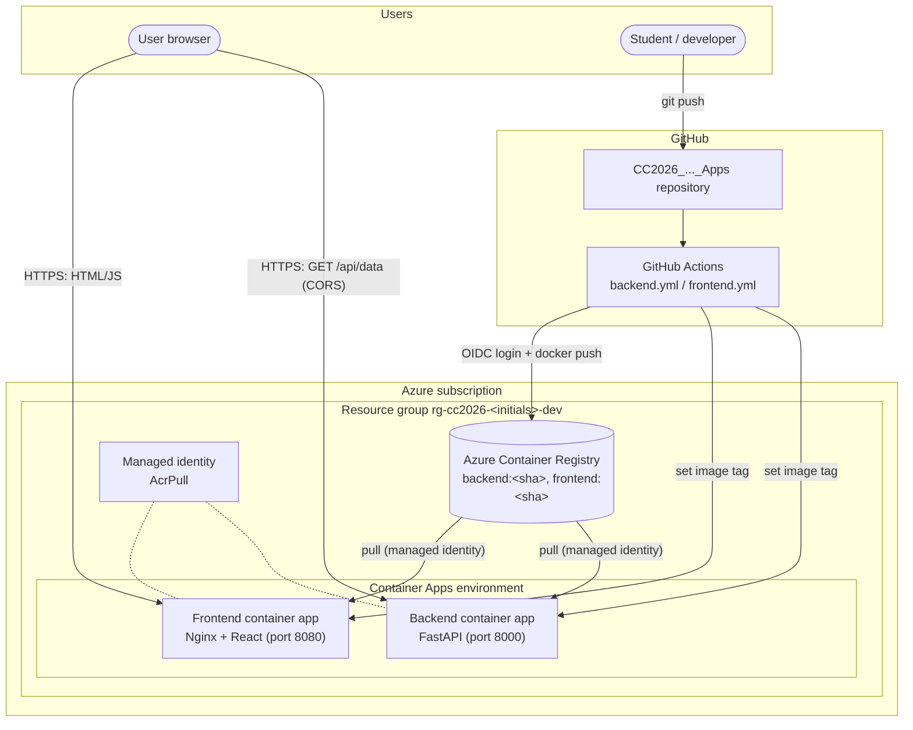
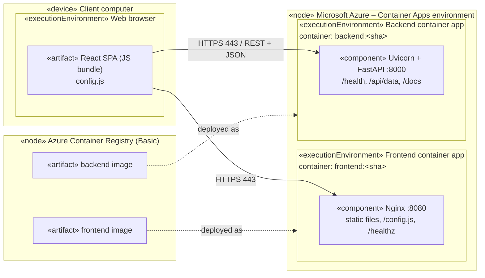
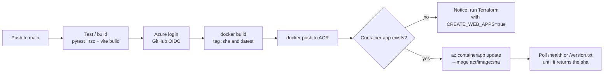

# Architecture – CC2026 Applications

Diagrams below describe what is actually deployed. Nothing else (no database, no gateway, no monitoring service) is deployed yet; later project parts extend this.

## Conceptual architecture

## UML deployment diagram

Mermaid has no native UML deployment diagram, so nodes and artifacts are drawn with UML stereotypes.

The Container Apps ingress terminates TLS on port 443 and forwards traffic to the target port of each app (8080 frontend, 8000 backend).

## CI/CD flow

Pull requests run only the test/build job. Azure credentials are never available to pull request runs.
