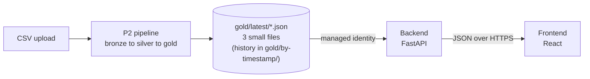

# P2 challenge: show the pipeline results in the app

In P2 you build an ETL pipeline (bronze, silver, gold). In this challenge you connect the Apps repository to the **gold** zone. The backend reads three small JSON files. The frontend shows a table and charts.

You write the code. This document gives the contract, the tasks and the checklist. It gives no solution.

## Student flow

1. **Infra repository (pipeline).** The template gives you silver and the worked example `daily_energy_by_device.json`. You build `energy_by_location.json` and `latest_readings.json`. **Bonus:** build one more gold file of your own. It must be a time grouping: hour of day, weekday or month.
2. **Backend.** Read the gold files with the managed identity of the backend. Serve them through new endpoints.
3. **Frontend.** Show a table and charts from the backend.

`docs/p2-sample-data/gold/latest/` holds the expected content of the first three files. Compare your pipeline output with them. Use them to build the UI before your pipeline works.

The bonus gold file has no sample. You define its schema and document it in your README. Serve it in the backend and show it in the frontend.

**Milestones**

- **Lab 2:** the gold files exist and the backend reads gold.
- **Homework:** the frontend (table and at least 2 charts).
- **Bonus:** the date range control and your own gold file.

## 1. Goal and architecture



```text
gold files --> backend (read, cache, serve) --> frontend (table + 2 charts)
```

The backend reads **gold only**. It never reads bronze or silver. The browser never gets the 500,000 raw rows.

## 2. Data contract

Each pipeline run writes three JSON files (each is a JSON array) twice:

- `gold/by-timestamp/<yyyyMMddTHHmmssZ>/<file>.json`: history, one folder per run.
- `gold/latest/<file>.json`: overwritten at each run.

**The backend reads only `latest`.** On Azure, the container is `gold` and the blob name is `latest/<file>.json`. On AWS, the key is `gold/latest/<file>.json`.

You will upload the dataset many times while you test. Each run adds a history folder. The backend must never read history. Optional: show in the UI when the data was generated. Bonus: list `by-timestamp/` to find the newest run.

| File | Records (full dataset) | Fields |
|---|---|---|
| `daily_energy_by_device.json` | 1825 | `device_id`, `location`, `date` (`YYYY-MM-DD`), `total_kwh`, `avg_temperature`, `avg_humidity`, `readings` |
| `energy_by_location.json` | 5 | `location`, `total_kwh`, `devices`, `avg_kwh_per_day` |
| `latest_readings.json` | 200, newest first | `device_id`, `timestamp` (UTC, `Z`), `temperature`, `humidity`, `kwh`, `location` |

Rounding: `total_kwh` has 3 decimals, averages have 2 decimals. Devices are `device-001` to `device-005`. Locations are Office-A, Server-Room, Lab, Cafeteria and Workshop.

Example records:

```json
// daily_energy_by_device.json
{"device_id": "device-001", "location": "Office-A", "date": "2025-11-01",
 "total_kwh": 18.419, "avg_temperature": 21.09, "avg_humidity": 55.02, "readings": 288}

// energy_by_location.json
{"location": "Server-Room", "total_kwh": 19586.318, "devices": 1, "avg_kwh_per_day": 53.661}

// latest_readings.json
{"device_id": "device-005", "timestamp": "2026-10-31T23:55:00Z",
 "temperature": 20.97, "humidity": 54.82, "kwh": 0.0378, "location": "Workshop"}
```

### Sample files

`docs/p2-sample-data/gold/latest/` holds the three files that the finished pipeline produces for the full dataset. Use them to build the backend and the UI before your pipeline runs. Your own pipeline output must match them.

## 3. Required work

### Backend (`backend/`)

1. Add `kwh` and `location` to the `Measurement` model. Keep the change additive.
2. Add a data source that reads the three gold files. Follow the existing `MeasurementSource` idea in `app/data.py`. The endpoints get the source through `get_measurement_source()`.
3. Read the files with the cloud identity of the backend. No keys.
   - **Azure:** `azure-identity` (`DefaultAzureCredential`) and `azure-storage-blob`. Env: `STORAGE_ACCOUNT_URL`, `GOLD_CONTAINER` (`gold`). The blob name is `latest/<file>.json`.
   - **AWS:** `boto3`. Env: `DATA_BUCKET`, `GOLD_PREFIX` (`gold/latest/`). The key is the prefix plus the file name.
4. If the env variables are not set, read the local sample files. Tests and `docker compose up` must still work with no cloud.
5. Cache the gold data for a short time (for example 60 seconds). Do not call storage on every request.
6. Add endpoints, for example: `GET /api/energy/daily` (optional `device_id`), `GET /api/energy/by-location`, `GET /api/readings/latest`. Bonus: add an endpoint for your own gold file. Validate inputs like the existing endpoints do.
   - Optional feature: daily energy and latest readings take optional `from` and `to` query parameters (ISO date, `YYYY-MM-DD`). An invalid date, or `from` after `to`, returns `422`.
7. Add tests. Use an injected fake source (`app.dependency_overrides`). No test may call the cloud.
8. Add the new libraries to `requirements.txt` with pinned versions. Add new settings to `app/config.py`.

### Frontend (`frontend/`)

1. Keep the table and the device filter. The table shows the latest readings.
2. Add at least **2 charts**. A small library (for example recharts) or hand-made SVG is fine.
3. Show a loading state and an error state for each data call.
4. Bonus: add a date range control for the charts. It uses the `from` and `to` filters.
5. Timestamps are UTC ISO 8601. Show them in the local time zone of the user, or write "UTC" next to them.
6. Keep the backend URL in the runtime `config.js`. Do not hard-code it.

### Chart ideas

- kWh per day for one device (line)
- kWh share per location (pie or donut)
- Average temperature against kWh (scatter)
- kWh by weekday (bar)
- Hourly load profile (24 bars)
- Top 10 days by kWh
- Monthly totals
- Cost estimate (kWh x tariff)
- Week-over-week change

## 4. Local development

Use the sample files. No cloud account is needed.

```bash
cd backend && python -m pytest && uvicorn app.main:app --reload
cd frontend && npm ci && npm run dev
docker compose up --build
```

For Docker, the sample files must be inside the backend image or mounted as a volume. Decide how and write it in your README.

### Run against real cloud data

Your pipeline must have run at least once. Never put keys in files.

- **Azure:** run `az login`. `DefaultAzureCredential` uses this login. Your user needs the role *Storage Blob Data Reader* (or *Contributor*) on the storage account. Set `STORAGE_ACCOUNT_URL=https://<account>.blob.core.windows.net` and `GOLD_CONTAINER=gold`.
- **AWS:** run `aws login`. boto3 uses these credentials. Your user needs `s3:GetObject` on `gold/latest/*`. Set `DATA_BUCKET` and `GOLD_PREFIX=gold/latest/`.

In Azure and AWS, the Terraform in the Infra repository gives the deployed backend its identity and sets the env variables.

## 5. Hints and code

Short snippets. They give the plumbing and the shape. You write the rest.

### Backend: read one gold file (full code)

Put this in a new file, for example `backend/app/gold.py`. It reads one JSON file from Azure, AWS or the local sample folder. It caches the result for 60 seconds. Create the client once, not per request.

```python
import json
import os
import time
from pathlib import Path

SAMPLE_DIR = Path(__file__).resolve().parents[2] / "docs" / "p2-sample-data" / "gold" / "latest"
CACHE_SECONDS = 60
_cache: dict[str, tuple[float, list]] = {}
_azure = _s3 = None


def _read_bytes(name: str) -> bytes:
    global _azure, _s3
    if account_url := os.getenv("STORAGE_ACCOUNT_URL"):  # Azure
        if _azure is None:
            from azure.identity import DefaultAzureCredential
            from azure.storage.blob import BlobServiceClient

            _azure = BlobServiceClient(account_url, credential=DefaultAzureCredential())
        container = os.getenv("GOLD_CONTAINER", "gold")
        return _azure.get_blob_client(container, f"latest/{name}").download_blob().readall()
    if bucket := os.getenv("DATA_BUCKET"):  # AWS
        if _s3 is None:
            import boto3

            _s3 = boto3.client("s3")
        key = os.getenv("GOLD_PREFIX", "gold/latest/") + name
        return _s3.get_object(Bucket=bucket, Key=key)["Body"].read()
    return (SAMPLE_DIR / name).read_bytes()  # local fallback


def read_gold(name: str) -> list:
    now = time.monotonic()
    hit = _cache.get(name)
    if hit and now - hit[0] < CACHE_SECONDS:
        return hit[1]
    data = json.loads(_read_bytes(name))
    _cache[name] = (now, data)
    return data
```

The sample path works when you run from the repository. In Docker, the folder is missing. See "Watch out".

### Backend: data source class (partial)

```python
class GoldMeasurementSource:
    """Reads gold JSON. Implements MeasurementSource."""

    def list_measurements(self) -> list[Measurement]:
        rows = read_gold("latest_readings.json")
        # TODO: convert each row to a Measurement (parse the timestamp, keep kwh and location)

    def daily_energy(self, device_id: str | None = None) -> list[DailyEnergy]:
        # TODO: read daily_energy_by_device.json, filter by device_id, return DailyEnergy models
        ...

    def energy_by_location(self) -> list[LocationEnergy]:
        # TODO
        ...
```

`DailyEnergy` and `LocationEnergy` are new Pydantic models in `models.py`. Their fields come from the data contract.

### Backend: one endpoint (partial)

```python
@app.get("/api/energy/by-location", response_model=list[LocationEnergy], tags=["energy"])
def energy_by_location(source: Annotated[GoldMeasurementSource, Depends(get_measurement_source)]):
    # TODO: call the source. Decide what happens when storage fails (502 or 503).
    ...
```

The type hint must match the source that `get_measurement_source()` returns. Think about how the in-memory default (P1 tests) and the gold source work together. A common choice: choose the source from the env variables.

### Frontend: fetch hook (skeleton)

```ts
export function useFetch<T>(path: string) {
  const [data, setData] = useState<T | null>(null)
  const [loading, setLoading] = useState(true)
  const [error, setError] = useState<string | null>(null)

  useEffect(() => {
    const controller = new AbortController()
    // TODO: fetch `${API_BASE_URL}${path}` with controller.signal
    // TODO: set data, or set a readable error. Ignore AbortError.
    // TODO: set loading to false at the end
    return () => controller.abort()
  }, [path])

  return { data, loading, error }
}
```

Look at `useMeasurements.ts` and `api.ts`. They already do this for one endpoint.

### Frontend: SVG donut (skeleton)

```tsx
interface Slice { label: string; value: number }

export function Donut({ slices }: { slices: Slice[] }) {
  const total = slices.reduce((sum, s) => sum + s.value, 0)
  const radius = 40
  const circumference = 2 * Math.PI * radius
  let offset = 0
  return (
    <svg viewBox="0 0 100 100" role="img" aria-label="kWh share per location">
      {slices.map((s, i) => {
        const length = (s.value / total) * circumference
        // TODO: draw one <circle> per slice with strokeDasharray and strokeDashoffset
        // TODO: pick a different color per slice
        offset += length
        return null
      })}
      {/* TODO: add a legend (HTML list under the svg is fine) */}
    </svg>
  )
}
```

Hint: a circle with a wide stroke, `strokeDasharray="<length> <rest>"` and a negative `strokeDashoffset` for each slice. Start at the top with `transform="rotate(-90 50 50)"`.

### Second chart (hint only)

Pick a line or bar chart from the ideas list. Compute x and y positions with a small scale function: `x = (value - min) / (max - min) * width`. Draw a `<polyline>` or `<rect>` elements. Or use recharts.

### Other hints

- Parse each file into Pydantic models. Reject bad data with a clear error.
- When storage fails, return `502` or `503` with a short message. Do not return a stack trace.
- Send the browser only what the chart needs.

## 6. What not to do

- Do not read bronze or silver. Do not send 500,000 rows to the browser.
- Do not use storage account keys, connection strings, SAS tokens or AWS access keys.
- Do not commit secrets, `.env` files or the Teams webhook URL.
- Do not call the cloud in tests.
- Do not change ports 8000 and 8080. Terraform uses them.

## Watch out

- Keep the in-memory source as the default. The P1 tests use it and must still pass.
- Add `azure-identity`, `azure-storage-blob` and `boto3` to `requirements.txt` with pinned versions.
- The backend image copies only `backend/`. Decide how the sample files reach the Docker image.
- The device filter is built from the loaded rows. Daily charts need their own device list (for example from `/api/devices` or from the daily data).

## 7. Acceptance checklist

| Check | P2 grading area |
|---|---|
| Upload of a CSV starts the pipeline. It writes silver and gold. The Teams card shows SUCCEEDED. An invalid file (`energy_invalid.csv`) shows FAILED. | Storage, ETL and notification work together |
| The backend serves the gold data through the new endpoints. | Working pipeline output |
| The frontend shows the table, the device filter and 2 charts, with loading and error states (homework). | Working pipeline output |
| `README.md` has an architecture diagram, clear steps and screenshots of the pipeline run, the Teams card and the app. | Documentation |
| Gold sample output is in the repository. | Sample input and output |
| Bonus: date range control and your own gold file with a documented schema. | Bonus |
| `python -m pytest` and `npm run build` pass. Commits are small and follow Conventional Commits. | Code quality |

The pipeline side is in the Infra repository: see `docs/p2-walkthrough.md` there.
