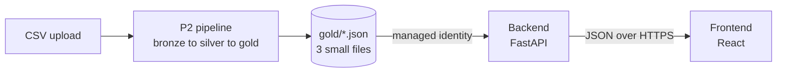

# P2 challenge: show the pipeline results in the app

In P2 you build an ETL pipeline (bronze, silver, gold). In this challenge you connect the Apps repository to the **gold** zone. The backend reads three small JSON files. The frontend shows a table and charts.

You write the code. This document gives the contract, the tasks and the checklist. It gives no solution.

## 1. Goal and architecture



```text
gold files --> backend (read, cache, serve) --> frontend (table + 2 charts)
```

The backend reads **gold only**. It never reads bronze or silver. The browser never gets the 500,000 raw rows.

## 2. Data contract

The pipeline overwrites three JSON files (each is a JSON array) at each run. The paths are `gold/<name>` in the storage account container `gold` (Azure) or under the prefix `gold/` in the bucket (AWS).

| File | Records (full dataset) | Fields |
|---|---|---|
| `daily_energy_by_device.json` | 1825 | `device_id`, `location`, `date` (`YYYY-MM-DD`), `total_kwh`, `avg_temperature`, `avg_humidity`, `readings` |
| `energy_by_location.json` | 5 | `location`, `total_kwh`, `devices`, `avg_kwh_per_day` |
| `latest_readings.json` | 200, newest first | `device_id`, `timestamp` (UTC, `Z`), `temperature`, `humidity`, `kwh`, `location` |

Rounding: `total_kwh` has 3 decimals, averages have 2 decimals. Devices are `device-001` to `device-005`. Locations are Office-A, Server-Room, Lab, Cafeteria and Workshop.

Example records:

```json
// daily_energy_by_device.json
{"device_id": "device-001", "location": "Office-A", "date": "2025-11-01",
 "total_kwh": 18.419, "avg_temperature": 21.09, "avg_humidity": 55.02, "readings": 288}

// energy_by_location.json
{"location": "Server-Room", "total_kwh": 19586.318, "devices": 1, "avg_kwh_per_day": 53.661}

// latest_readings.json
{"device_id": "device-005", "timestamp": "2026-10-31T23:55:00Z",
 "temperature": 20.97, "humidity": 54.82, "kwh": 0.0378, "location": "Workshop"}
```

### Sample files

`docs/p2-sample-data/gold/` holds the three files that the finished pipeline produces for the full dataset. Use them to build the backend and the UI before your pipeline runs. Your own pipeline output must match them.

## 3. Required work

### Backend (`backend/`)

1. Add `kwh` and `location` to the `Measurement` model. Keep the change additive.
2. Add a data source that reads the three gold files. Follow the existing `MeasurementSource` idea in `app/data.py`. The endpoints get the source through `get_measurement_source()`.
3. Read the files with the cloud identity of the backend. No keys.
   - **Azure:** `azure-identity` (`DefaultAzureCredential`) and `azure-storage-blob`. Env: `STORAGE_ACCOUNT_URL`, `GOLD_CONTAINER` (`gold`).
   - **AWS:** `boto3`. Env: `DATA_BUCKET`, `GOLD_PREFIX` (`gold/`).
4. If the env variables are not set, read the local sample files. Tests and `docker compose up` must still work with no cloud.
5. Cache the gold data for a short time (for example 60 seconds). Do not call storage on every request.
6. Add endpoints, for example: `GET /api/energy/daily` (optional `device_id`), `GET /api/energy/by-location`, `GET /api/readings/latest`. Validate inputs like the existing endpoints do.
7. Add tests. Use an injected fake source (`app.dependency_overrides`). No test may call the cloud.
8. Add the new libraries to `requirements.txt` with pinned versions. Add new settings to `app/config.py`.

### Frontend (`frontend/`)

1. Keep the table and the device filter. The table shows the latest readings.
2. Add at least **2 charts**. A small library (for example recharts) or hand-made SVG is fine.
3. Show a loading state and an error state for each data call.
4. Keep the backend URL in the runtime `config.js`. Do not hard-code it.

### Chart ideas

- kWh per day for one device (line)
- kWh share per location (pie or donut)
- Average temperature against kWh (scatter)
- kWh by weekday (bar)
- Hourly load profile (24 bars)
- Top 10 days by kWh
- Monthly totals
- Cost estimate (kWh x tariff)
- Week-over-week change

## 4. Local development

Use the sample files. No cloud account is needed.

```bash
cd backend && python -m pytest && uvicorn app.main:app --reload
cd frontend && npm ci && npm run dev
docker compose up --build
```

For Docker, the sample files must be inside the backend image or mounted as a volume. Decide how and write it in your README.

### Run against real cloud data

Your pipeline must have run at least once. Never put keys in files.

- **Azure:** run `az login`. `DefaultAzureCredential` uses this login. Your user needs the role *Storage Blob Data Reader* (or *Contributor*) on the storage account. Set `STORAGE_ACCOUNT_URL=https://<account>.blob.core.windows.net` and `GOLD_CONTAINER=gold`.
- **AWS:** run `aws login`. boto3 uses these credentials. Your user needs `s3:GetObject` on `gold/*`. Set `DATA_BUCKET` and `GOLD_PREFIX=gold/`.

In Azure and AWS, the Terraform in the Infra repository gives the deployed backend its identity and sets the env variables.

## 5. Hints

- Create the credential once, not per request.
- Parse each file into Pydantic models. Reject bad data with a clear error.
- When storage fails, return `502` or `503` with a short message. Do not return a stack trace.
- The identity call is short:

```python
from azure.identity import DefaultAzureCredential
from azure.storage.blob import BlobServiceClient

client = BlobServiceClient(account_url, credential=DefaultAzureCredential())
data = client.get_blob_client(container, "daily_energy_by_device.json").download_blob().readall()
```

```python
import boto3

body = boto3.client("s3").get_object(Bucket=bucket, Key=prefix + "latest_readings.json")["Body"].read()
```

- Sort or group in the backend. Send the browser only what the chart needs.

## 6. What not to do

- Do not read bronze or silver. Do not send 500,000 rows to the browser.
- Do not use storage account keys, connection strings, SAS tokens or AWS access keys.
- Do not commit secrets, `.env` files or the Teams webhook URL.
- Do not call the cloud in tests.
- Do not change ports 8000 and 8080. Terraform uses them.

## 7. Acceptance checklist

| Check | P2 grading area |
|---|---|
| Upload of a CSV starts the pipeline. It writes silver and gold. The Teams card shows SUCCEEDED. An invalid file (`energy_invalid.csv`) shows FAILED. | Storage, ETL and notification work together |
| The backend serves the gold data through the new endpoints. | Working pipeline output |
| The frontend shows the table, the device filter and 2 charts, with loading and error states. | Working pipeline output |
| `README.md` has an architecture diagram, clear steps and screenshots of the pipeline run, the Teams card and the app. | Documentation |
| Gold sample output is in the repository. | Sample input and output |
| `python -m pytest` and `npm run build` pass. Commits are small and follow Conventional Commits. | Code quality |

The pipeline side is in the Infra repository: see `docs/p2-walkthrough.md` there.
